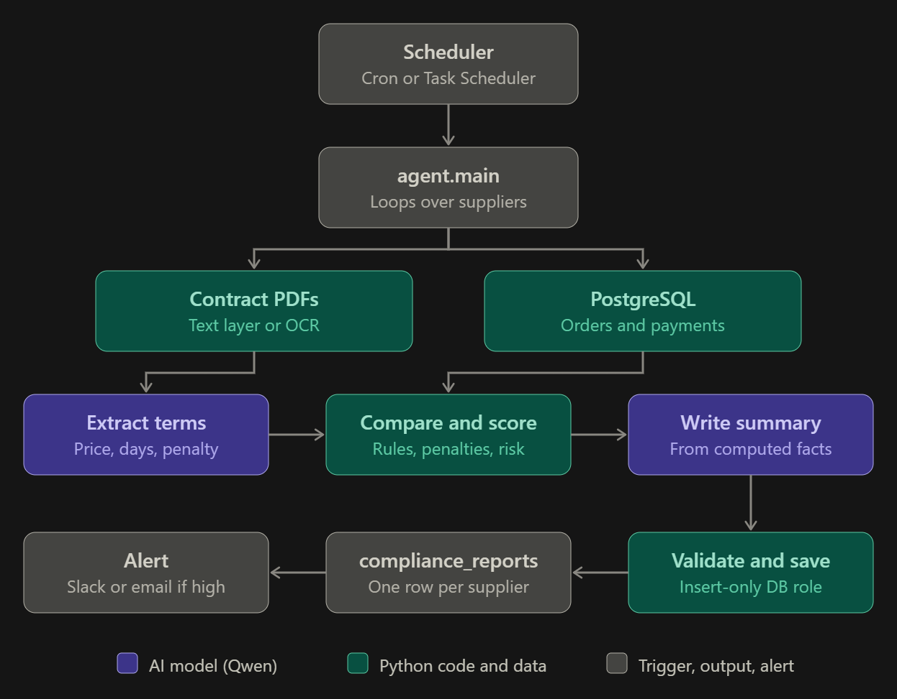

# Supplier Compliance Agent


## What this project does

It is an **automatic monthly auditor** for supplier payments. It checks whether your company paid its suppliers according to what the contracts say, and writes a report about it.

### The problem it solves

Your company has two sources of information:

* **Contracts (PDF files)** say what was agreed: the price per unit, how many days you have to pay (“net 30 days”), and the penalty for paying late (for example 2%).
* **A database (PostgreSQL)** says what actually happened: the purchase orders and the payments made.

Someone would normally compare the two by hand every month. This project does that comparison automatically.

### What it does, step by step

For each supplier, for a given month (for example `2026-10`), the project:

1. **Reads the database** to get that supplier’s purchase orders and payments.
2. **Reads the contract PDF.** If the PDF is a scanned image (like the Tokyo one), it uses OCR to read the text.
3. **Asks the local AI model (Qwen, running in Ollama)** to extract the contract terms: price, payment days and penalty percentage.
4. **Compares the two sources with plain Python code.** It finds problems such as:
   * a payment made too late (and the penalty owed);
   * a price different from the contract;
   * an unpaid or only partly paid order;
   * a payment made twice.
5. **Decides a risk level:** low, medium or high.
6. **Asks the AI to write a short readable summary** of the findings.
7. **Saves the report** into the `compliance_reports` table in the database.
8. **Sends an alert** (Slack or email) if the risk is high.




### Who does what

| Part                      | Job                                                                                                                           |
| ------------------------- | ----------------------------------------------------------------------------------------------------------------------------- |
| **AI model (Qwen)** | Reads the contract text and writes the summary. These are language tasks.                                                     |
| **Python code**     | Does all the dates, math, penalties and risk decisions. Small AI models make mistakes at calculations, so the code does them. |
| **PostgreSQL**      | Holds the orders, payments and the final reports.                                                                             |
| **Pydantic**        | Checks that every report is valid before it is saved.                                                                         |

### Safety built in

* The agent reads the database with a  **read-only user** , so it cannot change your data.
* It writes with a  **different user that can only add reports** , so it cannot delete or edit anything else.
* Every report is validated before saving.
* Running the same month twice does not create duplicates.
* Every run is logged in the `logs` folder.

## How it works

```
cron ─► main.py ─► for each supplier:
          db_tools.get_period_data ──► POs + payments of the month      (read-only role)
          pdf_tools.read_pdf       ──► contract text (OCR if scanned)
          llm.extract_contract_terms ► price, net N days, penalty %      (LLM, JSON schema)
          checks.run_checks        ──► issues: late, price, unpaid...   (plain Python)
          checks.compute_risk      ──► low / medium / high              (plain Python)
          llm.write_summary        ──► readable summary                 (LLM, number-checked)
          save_tools.save_report   ──► validate (Pydantic) + INSERT     (insert-only role)
          notify.send_alert        ──► Slack / email if risk is high
```

**Why a pipeline?** A 4B model is unreliable at date math and multi-step tool calls, so the LLM only
does language tasks (read the contract, write the summary). Python does all arithmetic and the risk
level. `--mode agent` lets the LLM drive the tools itself so you can compare.

Safety: separate DB roles (`agent_reader` SELECT-only, `agent_writer` INSERT on one table), a
SELECT-only SQL guard, Pydantic validation before insert, logs in `logs/`.

## Setup

```bash
# 1. system packages (OCR for scanned contracts)
sudo apt install tesseract-ocr poppler-utils        # macOS: brew install tesseract poppler

# 2. database
createdb supplier_demo
psql -d supplier_demo -f sql/setup.sql              # tables, sample data, agent_reader/agent_writer roles

# 3. python
python -m venv .venv && source .venv/bin/activate
pip install -e ".[dev]"

# 4. model + config
ollama pull qwen3.5:4b          # use the exact tag shown by `ollama list`
cp .env.example .env            # then set OLLAMA_MODEL and DB URLs if needed
```

## Run

```bash
python -m agent.main --period 2026-10 --dry-run     # print reports, write nothing
python -m agent.main --period 2026-10               # insert reports
python -m agent.main --period 2026-10 --supplier-id 3
python -m agent.main --period 2026-10 --supplier-id 1 --mode agent --dry-run   # LLM drives the tools
python -m agent.main --period 2026-10 --force       # add a new row even if a report exists
```

No `--period` = previous month. Re-running is safe: an existing (supplier, period) report is
skipped. The writer role cannot UPDATE/DELETE, so `--force` inserts a newer row (history is kept).

Check results:

```sql
SELECT supplier_id, period, risk_level, summary FROM compliance_reports ORDER BY created_at DESC;
```

## Tests

```bash
pytest                 # rules vs ANSWER_KEY, SQL guard, PDF/OCR, DB tests (skipped if DB is down)
RUN_E2E=1 pytest -m e2e   # full run with Ollama (slow)
```

## Schedule (1st of each month, 06:00)

```cron
0 6 1 * * /full/path/supplier-compliance-agent/scripts/run_monthly.sh
```

With Docker: `docker compose up -d db`, then `USE_DOCKER=1` in the cron line. Ollama stays on the host.

## Tuning the risk rules

Constants at the top of `src/agent/checks.py` (`HIGH_IMPACT_THRESHOLD`, `VERY_LATE_DAYS`, severities).

## Troubleshooting

- *Cannot reach Ollama*: run `ollama serve`; check `OLLAMA_HOST`.
- *Wrong contract terms extracted*: run one supplier with `--dry-run` and read `logs/agent_*.log`
  (it logs the extracted terms). Improve the example in `prompts.py`.
- *OCR error*: install Tesseract and poppler.


docker compose up -d db

python -m venv .venv
.venv\Scripts\Activate.ps1
pip install -e ".[dev]"

ollama list


#### **Run tests**

pytest

## **Who to run the project:**

docker compose build agent
docker compose up -d db
docker compose run --rm agent python -m agent.main --period 2026-10 --supplier-id 5 --dry-run     /


docker compose run --rm agent python -m agent.main --period 2026-10

docker compose exec db psql -U postgres -d supplier_demo -c "SELECT id, supplier_id, period, risk_level, left(summary, 60) AS summary FROM compliance_reports ORDER BY id;"


docker compose exec db psql -U postgres -d supplier_demo -c "SELECT supplier_id, jsonb_pretty(issues_json) FROM compliance_reports WHERE supplier_id = 5;"
